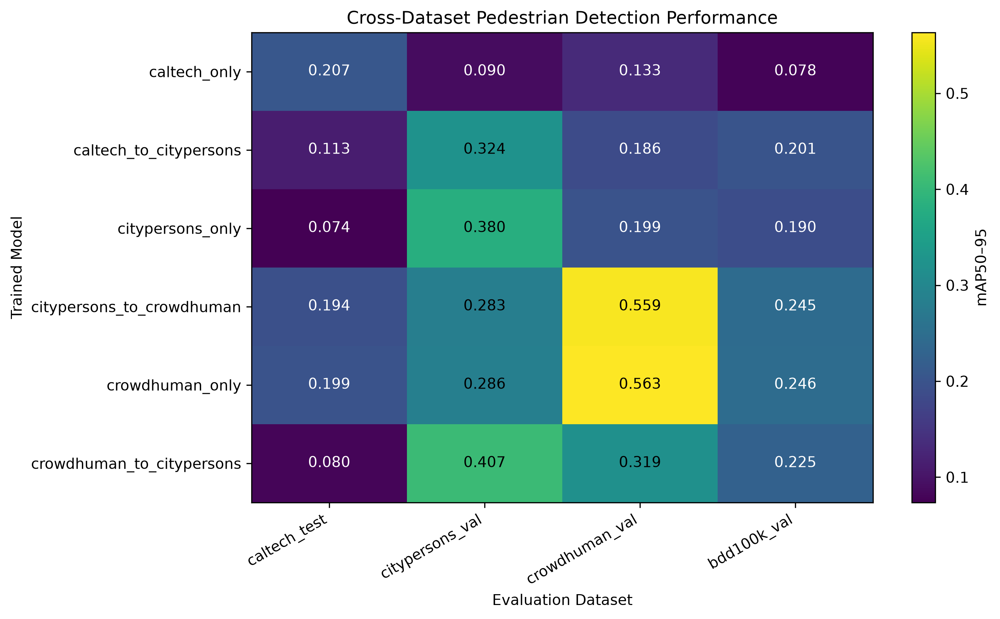
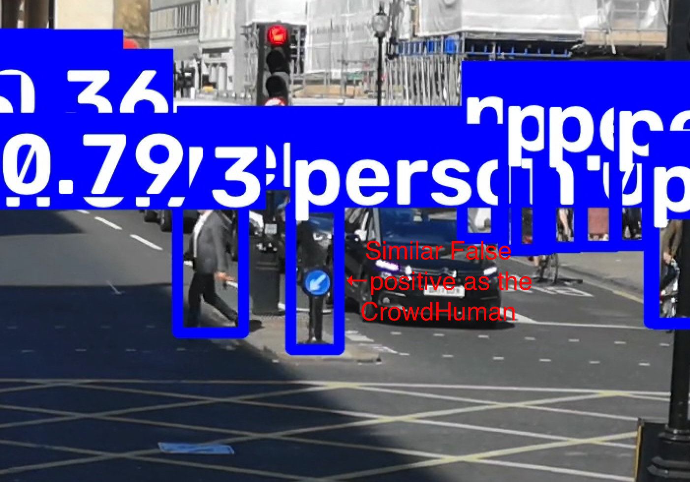
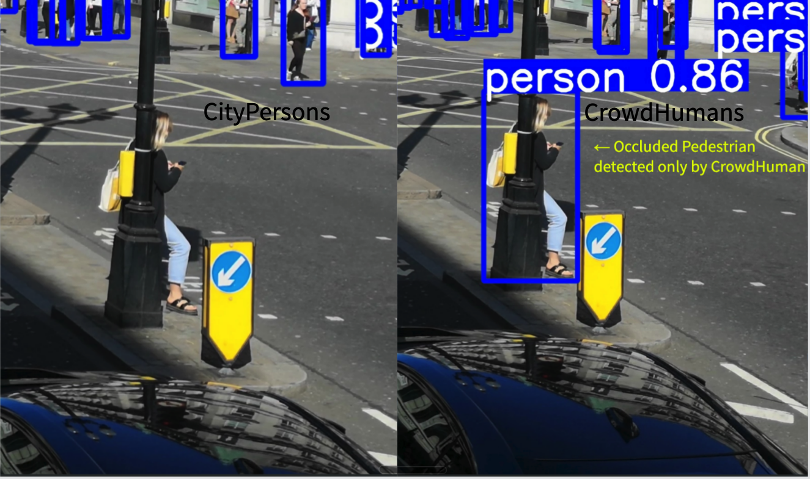
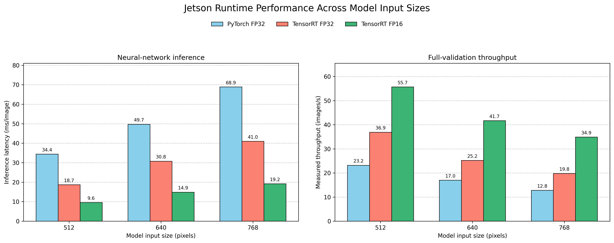
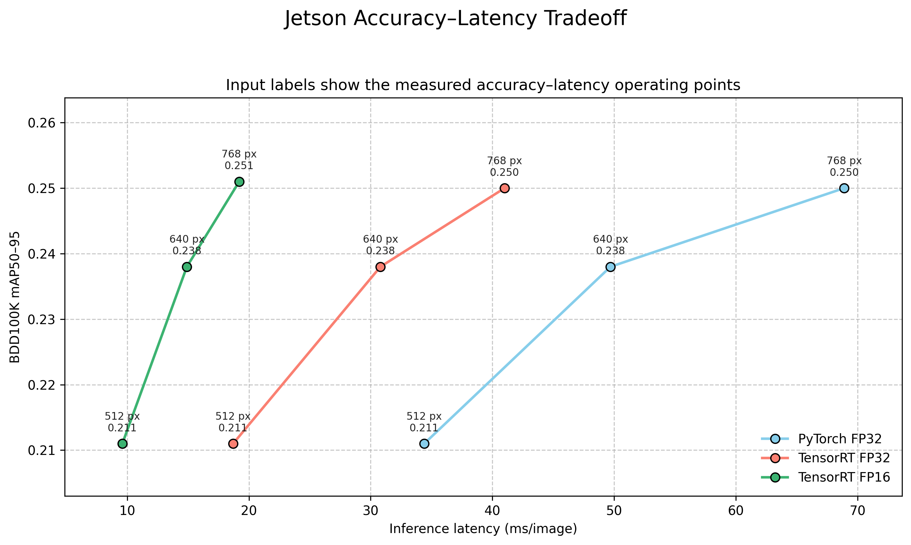

# Cross-Dataset Pedestrian Detection and Edge Deployment with YOLOv8m

An end-to-end pedestrian-detection study spanning **cross-domain model
selection** and **real-device optimization on NVIDIA Jetson Orin Nano**. The
same single-class YOLOv8m detector connects both phases.

| Phase | Scope | Headline result |
|---|---|---|
| Cross-domain research | 6 training strategies × 4 evaluation domains = 24 evaluations | CrowdHuman-only delivered the strongest overall cross-domain behavior and the best BDD100K research result (`mAP50–95=0.246`) |
| Edge deployment | PyTorch FP32 and TensorRT FP32/FP16 at 512, 640, and 768 | At input 512, TensorRT FP16 cut inference from **34.4 ms to 9.6 ms** (**3.58× faster**) while BDD100K `mAP50–95` remained **0.211** |

## Highlights

- Trained and compared **6 YOLOv8m pedestrian detectors** across
  single-dataset and sequential-transfer strategies.
- Evaluated every model on Caltech, CityPersons, CrowdHuman, and the external
  BDD100K domain; the resulting heatmap exposes strong domain specialization.
- Selected CrowdHuman-only for its balanced generalization, then carried that
  exact checkpoint into the deployment phase.
- Benchmarked a complete **3 runtimes/precisions × 3 input sizes** matrix on an
  8 GB Jetson Orin Nano Super, retaining raw validation evidence for every row.
- TensorRT FP16 preserved accuracy relative to PyTorch at fixed resolution and
  delivered **3.34×–3.59× faster neural-network inference**.
- Measured resolution, power-mode, integrated-NMS, and video-pipeline tradeoffs;
  retained INT8 as a documented negative result rather than a claimed win.

### Detailed Documentation

- [Model inventory and training strategies](models/README.md)
- [Cross-dataset evaluation](cross_dataset_validation/README.md)
- [Qualitative analysis](qualitative/README.md)
- [Jetson deployment, benchmarks, and evidence](deployment/jetson/README.md)

---

## 1. Project Questions

### Research question

> **How does the choice of training dataset affect cross-domain performance in pedestrian detection?**

The experiments additionally investigate:

1. How strongly single-dataset models specialize to their training domain.
2. Whether broader pedestrian training exposure is associated with stronger cross-domain robustness.
3. How sequential training compares with training only on the final dataset.
4. Whether the **direction of sequential fine-tuning** changes final model behavior.
5. How much earlier-domain behavior is retained after fine-tuning on a second dataset.
6. Which training strategy generalizes most effectively to a common unseen domain.
7. How domain shift affects precision, recall, and qualitative failure behavior.

### Deployment question

> **How much inference performance can TensorRT and reduced precision gain on
> Jetson Orin Nano, and what accuracy, power, and pipeline tradeoffs accompany
> those gains?**

The deployment phase keeps model input size, source-video resolution,
neural-network latency, and full-pipeline throughput separate so that each
claim has a clear measurement boundary.

---

## 2. Model Training and Evaluation Design

All experiments use **YOLOv8m** as a single-class pedestrian detector.

Three models were trained independently:

* **Caltech only**
* **CityPersons only**
* **CrowdHuman only**

Three additional models used sequential fine-tuning:

* **Caltech → CityPersons**
* **CityPersons → CrowdHuman**
* **CrowdHuman → CityPersons**

Each model was then evaluated on:

* **Caltech Test**
* **CityPersons Validation**
* **CrowdHuman Validation**
* **BDD100K Validation**

This produced:

**6 models × 4 evaluation domains = 24 evaluations**

BDD100K was not used in any of the project training sequences and therefore serves as a common external domain for comparing model generalization.

---

## 3. Cross-Dataset Evaluation

The primary comparison metric is **mAP50–95**.

| Model                        | Caltech Test | CityPersons Val | CrowdHuman Val | BDD100K Val |
| ---------------------------- | -----------: | --------------: | -------------: | ----------: |
| **Caltech only**             |    **0.207** |           0.090 |          0.133 |       0.078 |
| **Caltech → CityPersons**    |        0.113 |           0.324 |          0.186 |       0.201 |
| **CityPersons only**         |        0.074 |           0.380 |          0.199 |       0.190 |
| **CityPersons → CrowdHuman** |        0.194 |           0.283 |          0.559 |       0.245 |
| **CrowdHuman only**          |        0.199 |           0.286 |      **0.563** |   **0.246** |
| **CrowdHuman → CityPersons** |        0.080 |       **0.407** |          0.319 |       0.225 |

### Cross-Dataset Performance



The heatmap highlights substantial domain dependence. No single training strategy dominates every evaluation dataset, but several consistent patterns emerge.

---

## 4. Domain-Generalization Findings

### 4.1 Strong In-Domain Performance Does Not Guarantee Generalization

The **Caltech-only** detector achieved the highest mAP50–95 on Caltech Test:

```text
Caltech Test       0.207
CityPersons Val    0.090
CrowdHuman Val     0.133
BDD100K Val        0.078
```

Its performance deteriorated sharply outside the Caltech domain and reached the lowest result of all six models on BDD100K.

Under this experimental setup, Caltech therefore provides the clearest example of **source-domain specialization**.

---

### 4.2 CrowdHuman Produced the Strongest Overall Single-Dataset Generalization

The CrowdHuman-only detector achieved:

```text
Caltech Test       0.199
CityPersons Val    0.286
CrowdHuman Val     0.563
BDD100K Val        0.246
```

Although it did not rank first on every dataset, it remained competitive across multiple domains and achieved the strongest independent BDD100K result.

This suggests that the pedestrian variation represented by CrowdHuman was associated with stronger cross-domain robustness under the training setup used here.

Dataset diversity itself was not experimentally isolated from other factors such as dataset scale, pedestrian density, annotation characteristics, and scene composition, so this should not be interpreted as a causal conclusion about diversity alone.

---

### 4.3 CityPersons → CrowdHuman Converged Toward CrowdHuman-Only Behavior

CityPersons → CrowdHuman and CrowdHuman-only produced nearly identical results:

| Evaluation Domain      | CrowdHuman Only | CityPersons → CrowdHuman |
| ---------------------- | --------------: | -----------------------: |
| Caltech Test           |           0.199 |                    0.194 |
| CityPersons Validation |           0.286 |                    0.283 |
| CrowdHuman Validation  |           0.563 |                    0.559 |
| BDD100K Validation     |           0.246 |                    0.245 |

The similarity also appeared during qualitative inspection, including instances where the two detectors reproduced similar detection behavior and even the same false-positive tendency in a selected scene.



Taken together, these results suggest that **the later CrowdHuman stage largely dominated the earlier CityPersons stage under this training configuration**.

This does not establish that smaller-to-larger sequential training is ineffective in general.

---

### 4.4 Transfer Direction Matters

The reverse training sequence behaved differently.

On CityPersons validation:

| Model                        |  mAP50–95 |
| ---------------------------- | --------: |
| CityPersons only             |     0.380 |
| **CrowdHuman → CityPersons** | **0.407** |

CrowdHuman → CityPersons also retained stronger performance than CityPersons-only on CrowdHuman and BDD100K:

| Evaluation Domain     | CityPersons Only | CrowdHuman → CityPersons |
| --------------------- | ---------------: | -----------------------: |
| CrowdHuman Validation |            0.199 |                **0.319** |
| BDD100K Validation    |            0.190 |                **0.225** |

Qualitatively, the sequential detector showed some CrowdHuman-like behavior, including additional detections and improved handling of some occluded pedestrians, while also developing failure patterns similar to CityPersons-only.

This suggests **partial retention of earlier-domain behavior alongside adaptation toward the final training domain**.

[See the detailed transfer comparison →](qualitative/README.md)

---

## 5. Qualitative Comparisons

Quantitative metrics describe aggregate detector behavior, but they do not always reveal **which types of pedestrian instances are being detected or missed**.

Three common video frames were therefore inspected across the models at **2 s, 7 s, and 22 s**.

The selected cases include:

* distant pedestrians;
* partially occluded pedestrians;
* clear missed detections;
* differences in apparent recall;
* and false positives.

### Occlusion Example



In this example, CrowdHuman-only detects a pedestrian substantially obscured by a streetlight pole, while CityPersons-only misses the instance.

Other selected scenes showed similar differences in difficult pedestrian detections.

CrowdHuman's greater sensitivity was not universally beneficial: a separate selected example also records a false-positive pedestrian detection on a street fixture.

These examples are **illustrative rather than statistical evidence**. The quantitative conclusions of the project are based on the complete cross-dataset evaluation.

[View the full qualitative analysis →](qualitative/README.md)

---

## 6. Model Selection

The **CrowdHuman-only YOLOv8m** detector was selected as the primary model for downstream work.

The selection was based on its overall cross-domain behavior rather than its source-domain score alone.

In particular, it:

* achieved the highest CrowdHuman validation result;
* achieved the highest independent BDD100K mAP50–95;
* remained competitive on Caltech;
* and showed qualitatively stronger handling of several difficult pedestrian cases.

The selected checkpoint was subsequently used for the integrated Jetson
deployment and TensorRT optimization phase below.

---

## 7. Edge Deployment and TensorRT Optimization

Deployment was measured on an **NVIDIA Jetson Orin Nano Super Developer Kit
(8 GB)** using JetPack 6.2.1, CUDA 12.6, batch 1, and the BDD100K validation
set. The canonical matrix compares PyTorch FP32, TensorRT FP32, and TensorRT
FP16 at model inputs 512, 640, and 768.

### Matched 512-pixel result

| Runtime | Precision | Inference | mAP50–95 | Full-validation throughput |
|---|---|---:|---:|---:|
| PyTorch | FP32 | 34.4 ms | 0.211 | 23.2 images/s |
| TensorRT | FP32 | 18.7 ms | 0.211 | 36.9 images/s |
| TensorRT | FP16 | **9.6 ms** | **0.211** | **55.7 images/s** |

At a fixed input size, TensorRT acceleration preserved measured accuracy while
reducing neural-network inference latency by **3.58×** from PyTorch FP32 to
TensorRT FP16. Full-validation throughput improved by **2.40×**; it includes
data loading and other pipeline overhead and is therefore not `1000 / latency`.



The paired panels keep neural-network latency separate from measured
full-validation throughput while using fixed runtime colors across input sizes.

### Accuracy–latency operating points

| TensorRT FP16 input | Precision | Recall | mAP50–95 | Inference |
|---:|---:|---:|---:|---:|
| 768 | 0.700 | 0.467 | **0.251** | 19.2 ms |
| 640 | 0.674 | 0.453 | 0.238 | 14.9 ms |
| 512 | 0.666 | 0.404 | 0.211 | **9.6 ms** |

Input 512 is the latency-first point; 768 preserves more detection quality;
640 is a measured middle ground. The research-phase BDD100K score (`0.246` on
Mac/MPS) and Jetson score (`0.250`/`0.251` at 768) come from different software
and hardware environments, so deployment speedups use only matched Jetson
baselines.



### Full-pipeline and deployment findings

| Source-video configuration (`imgsz=768`) | End-to-end throughput |
|---|---:|
| 4K, save annotated video | 2.095 FPS |
| 4K, no output save | 12.520 FPS |
| 1080p, no output save | 17.022 FPS |
| 720p, no output save | 18.535 FPS |

- The neural-network input remained 768 in this video sweep; changing source
  resolution affected decode, resize, drawing, and encoding overhead.
- At FP16/768, the 25W mode reduced inference to 20.6 ms versus 28.4 ms at 15W;
  MAXN_SUPER reached 19.3 ms but raised average sampled board power from 13.55 W
  to 15.44 W relative to 25W.
- Integrated TensorRT NMS reduced repeated-run postprocessing but produced lower
  recorded accuracy, so it is not the canonical accuracy engine.
- The retained INT8 experiment was both slower and less accurate than FP16 at
  768 (22.0 ms and 0.167 mAP50–95); it is documented as a negative result.

The full matrix, hardware/software inventory, Docker workflow, power analysis,
video protocol, raw-evidence status, limitations, and excluded-artifact manifest
are in the [Jetson deployment report](deployment/jetson/README.md).

---

## 8. Repository Structure

```text
pedestrian-detection-yolov8/
├── README.md
├── LICENSE
├── requirements.txt
│
├── analysis/
│   ├── figures/
│   └── summary_tables/
│
├── models/
│   ├── README.md
│   ├── single_dataset/
│   └── transfer/
│
├── cross_dataset_validation/
│   ├── README.md
│   ├── combined_validation_summary.csv
│   ├── caltech_test/
│   ├── citypersons_val/
│   ├── crowdhuman_val/
│   └── bdd100k_val/
│
├── deployment/
│   └── jetson/
│       ├── README.md
│       ├── benchmarks/
│       ├── logs/
│       ├── scripts/
│       ├── configs/
│       └── artifacts/
│
├── qualitative/
│   ├── README.md
│   ├── frames/
│   ├── selected/
│   ├── single_dataset_predictions/
│   └── transfer_predictions/
│
└── scripts/
    └── visualization/
```

### `models/`

Contains model-training metadata, configurations, training curves, samples, and the provenance of the six evaluated model variants.

[Model documentation →](models/README.md)

### `cross_dataset_validation/`

Contains all 24 model–dataset evaluation runs, individual evaluation artifacts, the combined quantitative results, and detailed interpretation.

[Cross-dataset evaluation →](cross_dataset_validation/README.md)

### `qualitative/`

Contains common source frames, unedited model predictions, curated comparisons, and qualitative interpretation of model behavior.

[Qualitative analysis →](qualitative/README.md)

### `analysis/`

Contains derived summary tables and the visualizations used to compare model performance across domains.

### `deployment/jetson/`

Contains the detailed Jetson report, benchmark summary tables, canonical raw
validation logs, power/video diagnostics, export logs, reproducibility scripts,
portable configuration, and a manifest for intentionally excluded artifacts.

[Jetson deployment report →](deployment/jetson/README.md)

---

## 9. Reproducibility

### Cross-domain evaluation protocol

Cross-dataset evaluations were performed using:

| Parameter            | Value |
| -------------------- | ----: |
| Image size           |   768 |
| Batch size           |    16 |
| Confidence threshold | 0.001 |
| NMS IoU threshold    |   0.7 |
| Maximum detections   |   300 |

Recorded metrics include:

- Precision
- Recall
- F1
- mAP50
- mAP75
- mAP50–95
- Preprocessing time
- Inference time
- Postprocessing time

Accuracy and generalization metrics are the primary focus of this protocol.
Jetson measurements use batch 1 and matched backend/input-size comparisons;
their separate protocol and evidence status are documented in
[`deployment/jetson/`](deployment/jetson/README.md).

### Figure generation

After installing the environment described below, all quantitative figures can
be generated with Python from canonical CSV files. The shared style module keeps
research and deployment typography, colors, grids, annotations, and export
settings consistent.

```bash
python scripts/visualization/plot_jetson_benchmarks.py
```

Research-figure commands, Jetson source mappings, and the runtime color key are
documented in [`scripts/visualization/README.md`](scripts/visualization/README.md).

### Environments

Install the Python dependencies used by the included analysis and model workflows:

```bash
python3 -m venv .venv
source .venv/bin/activate
python -m pip install -r requirements.txt
```

Exact training configurations for individual experiments are preserved alongside the corresponding models in [`models/`](models/).

Jetson package versions, power state, unresolved TensorRT-version boundaries,
and representative deployment commands are preserved in the
[deployment report](deployment/jetson/README.md#3-hardware-and-software).

Model weights, source datasets, TensorRT engines, and media are excluded from
Git. Training metadata, metrics, figures, validation logs, checksums, and
lightweight evaluation artifacts are retained to preserve provenance.

### Data and media attribution

The project uses pedestrian data from:

- Caltech Pedestrian Dataset
- CityPersons
- CrowdHuman
- BDD100K

The qualitative comparison uses an external urban street video from Pexels:

[**People and Vehicles on the Streets during Daytime**](https://www.pexels.com/video/people-and-vehicles-on-the-streets-during-daytime-2954065/)
by **George Morina**, via Pexels under the [Pexels
License](https://www.pexels.com/license/).

The Pexels footage was used for qualitative inspection and Jetson
video-pipeline benchmarking. It was not part of model training or BDD100K
accuracy evaluation.

---

## 10. Limitations

The conclusions in this repository are specific to:

- YOLOv8m;
- the preprocessing used in this project;
- the chosen training configuration;
- the selected dataset splits;
- the six training strategies evaluated;
- the Jetson/software configuration and operating modes measured;
- and the reported evaluation protocols.

The experiments do not establish universal conclusions about transfer learning or pedestrian-detection datasets.

In particular:

- dataset scale, annotation style, scene composition, and pedestrian density differ between datasets and were not independently controlled;
- the CityPersons → CrowdHuman result should be interpreted as CrowdHuman dominating the earlier training stage **under this setup**, not as proof that sequential training cannot help in other configurations;
- qualitative examples are deliberately selected to illustrate observed behaviors and should not be treated as statistical evidence;
- TensorRT timing and plan files are device/runtime-specific, and the retained
  host inventory and export environment report different TensorRT versions;
- integrated-NMS accuracy and several secondary timing rows survive only as
  summary records, not complete raw console captures;
- video throughput comes from one 884-frame scene and should not be generalized
  to arbitrary cameras, codecs, storage, or output settings;
- INT8 did not improve this deployment: the retained engine was slower and less
  accurate than FP16, while three fresh-calibration rebuilds failed with OOM.

---

## 11. Conclusions

The experiments demonstrate that **pedestrian-detection generalization is strongly dependent on training domain**.

CrowdHuman-based training produced the strongest overall cross-domain behavior in this study, while Caltech-only exhibited substantial source-domain specialization. Sequential fine-tuning produced different outcomes depending on direction: CityPersons → CrowdHuman converged toward CrowdHuman-only behavior, while CrowdHuman → CityPersons retained some earlier-domain robustness while adapting toward CityPersons.

Together, the results emphasize that selecting a pedestrian-detection training strategy requires considering **where a detector will ultimately be deployed**, rather than relying on in-domain validation performance alone.

The deployment phase turns that selection into a measured edge system. At a
fixed 512-pixel input, TensorRT FP16 preserved `mAP50–95=0.211` while reducing
inference latency from 34.4 ms to 9.6 ms. The wider experiments show why a
single FPS headline is insufficient: model input, source resolution, output
encoding, power mode, NMS placement, and precision all shape the final result.

## References and Resources

### Datasets and Benchmarks

1. **Caltech Pedestrian Dataset**  
   P. Dollár, C. Wojek, B. Schiele, and P. Perona,  
   *“Pedestrian Detection: A Benchmark,”*  
   IEEE Conference on Computer Vision and Pattern Recognition (CVPR), 2009.  
   [Paper / Dataset Reference](https://doi.org/10.1109/CVPR.2009.5206631)

2. **CityPersons**  
   S. Zhang, R. Benenson, and B. Schiele,  
   *“CityPersons: A Diverse Dataset for Pedestrian Detection,”*  
   IEEE Conference on Computer Vision and Pattern Recognition (CVPR), 2017.  
   [Paper](https://openaccess.thecvf.com/content_cvpr_2017/html/Zhang_CityPersons_A_Diverse_CVPR_2017_paper.html)

3. **Cityscapes**  
   M. Cordts, M. Omran, S. Ramos, T. Rehfeld, M. Enzweiler, R. Benenson,
   U. Franke, S. Roth, and B. Schiele,  
   *“The Cityscapes Dataset for Semantic Urban Scene Understanding,”*  
   IEEE Conference on Computer Vision and Pattern Recognition (CVPR), 2016.  
   [Dataset / Citation](https://www.cityscapes-dataset.com/citation/)

   CityPersons provides pedestrian annotations on images from the Cityscapes dataset.

4. **CrowdHuman**  
   S. Shao, Z. Zhao, B. Li, T. Xiao, G. Yu, X. Zhang, and J. Sun,  
   *“CrowdHuman: A Benchmark for Detecting Human in a Crowd,”* 2018.  
   [Paper](https://arxiv.org/abs/1805.00123)

5. **BDD100K**  
   F. Yu, H. Chen, X. Wang, W. Xian, Y. Chen, F. Liu, V. Madhavan,
   and T. Darrell,  
   *“BDD100K: A Diverse Driving Dataset for Heterogeneous Multitask Learning,”*  
   IEEE/CVF Conference on Computer Vision and Pattern Recognition (CVPR), 2020.  
   [Paper](https://openaccess.thecvf.com/content_CVPR_2020/html/Yu_BDD100K_A_Diverse_Driving_Dataset_for_Heterogeneous_Multitask_Learning_CVPR_2020_paper.html)

6. **Microsoft COCO**  
   T.-Y. Lin, M. Maire, S. Belongie, L. Bourdev, R. Girshick, J. Hays,
   P. Perona, D. Ramanan, C. L. Zitnick, and P. Dollár,  
   *“Microsoft COCO: Common Objects in Context,”*  
   European Conference on Computer Vision (ECCV), 2014.  
   [Paper](https://arxiv.org/abs/1405.0312)

   COCO-pretrained Ultralytics YOLOv8m weights were used as the initial
   pretrained detector before pedestrian-specific fine-tuning.

---

### Model and Framework

7. **Ultralytics YOLOv8**  
   G. Jocher, A. Chaurasia, and J. Qiu,  
   *Ultralytics YOLOv8*, 2023.  
   [YOLOv8 Documentation](https://docs.ultralytics.com/models/yolov8/) ·
   [Ultralytics Repository](https://github.com/ultralytics/ultralytics)

8. **PyTorch**  
   PyTorch was used as the underlying deep-learning framework for model
   training and inference.  
   [PyTorch](https://pytorch.org/)

---

### Source Video

The qualitative and Jetson video-pipeline analyses use external urban street
footage from Pexels:

[People and Vehicles on the Streets during Daytime](https://www.pexels.com/video/people-and-vehicles-on-the-streets-during-daytime-2954065/)
by **George Morina**, via Pexels under the [Pexels
License](https://www.pexels.com/license/).

The video was not part of model training or BDD100K accuracy evaluation.

---

### License

This project's original code is released under the [MIT License](LICENSE).
Third-party datasets, pretrained models, and media remain subject to their
respective licenses and terms of use.

***
