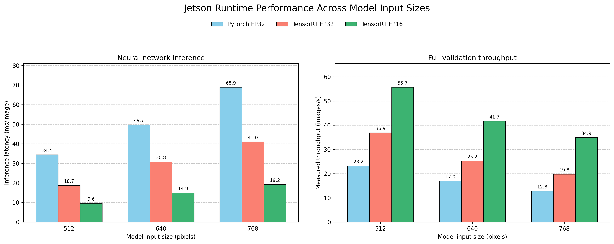
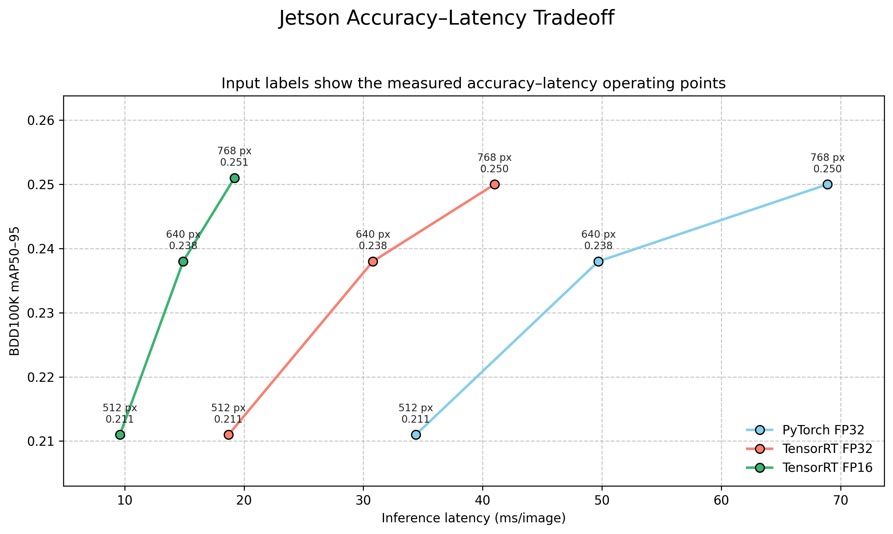
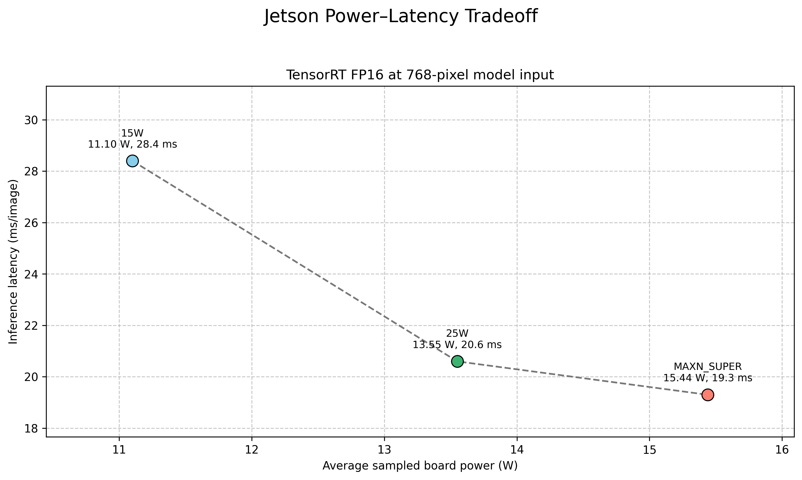
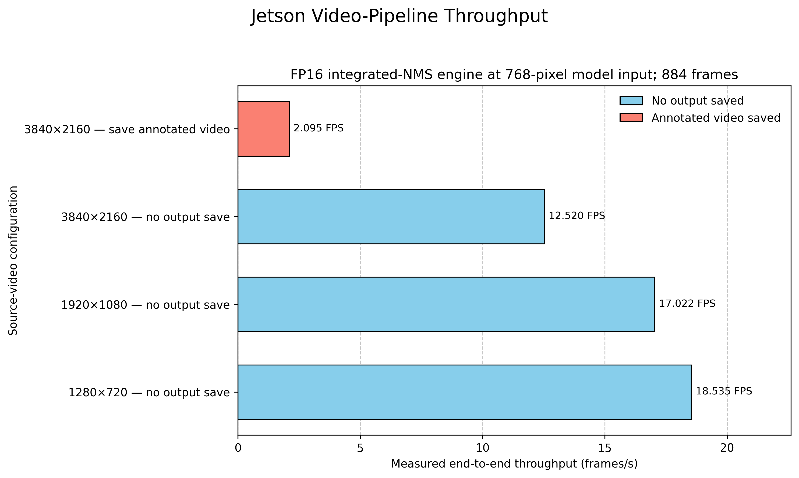

# YOLOv8m Pedestrian Detection on NVIDIA Jetson Orin Nano

Edge deployment, TensorRT optimization, and accuracy–latency tradeoffs.

> **Key result:** at a 512-pixel model input, TensorRT FP16 reduced measured
> neural-network inference latency from **34.4 ms to 9.6 ms** (**3.58× faster**)
> while mAP50–95 remained **0.211** on BDD100K validation. Full-validation
> throughput increased from **23.2 to 55.7 images/s**; that wall-clock rate is
> distinct from `1000 / inference_ms`.

## 1. Deployment Objective

This deployment phase asks:

> How much inference performance can be gained through TensorRT optimization
> and reduced numerical precision, and what detection-accuracy tradeoffs appear
> as model input resolution is reduced?

Four measurements are kept separate throughout:

- **Source resolution:** decoded image or video dimensions, such as 4K or 1080p.
- **Model input (`imgsz`):** the preprocessed tensor size, such as 768×768.
- **Inference latency:** time spent in the neural-network inference stage.
- **End-to-end throughput:** measured wall-clock processing rate, including
  applicable decode, resize, postprocessing, drawing, and output overhead.

## 2. Selected Model

The deployed model is the single-class (`{0: person}`) **CrowdHuman-only
YOLOv8m** detector selected by this repository's
[training and cross-domain study](../../README.md).
All six strategies were evaluated at `imgsz=768`:

| Training strategy | Caltech | CityPersons | CrowdHuman | BDD100K |
|---|---:|---:|---:|---:|
| Caltech only | 0.207 | 0.090 | 0.133 | 0.078 |
| Caltech → CityPersons | 0.113 | 0.324 | 0.186 | 0.201 |
| CityPersons only | 0.074 | 0.380 | 0.199 | 0.190 |
| CityPersons → CrowdHuman | 0.194 | 0.283 | 0.559 | 0.245 |
| **CrowdHuman only** | **0.199** | **0.286** | **0.563** | **0.246** |
| CrowdHuman → CityPersons | 0.080 | 0.407 | 0.319 | 0.225 |

CrowdHuman-only offered the strongest overall off-domain result in this study,
including the best BDD100K score. CityPersons → CrowdHuman was nearly
identical, which indicates that the later CrowdHuman stage dominated under this
specific training setup—not that sequential training is universally ineffective.
The reverse order retained different behavior, so transfer direction matters.

## 3. Hardware and Software

| Component | Recorded configuration |
|---|---|
| Device | NVIDIA Jetson Orin Nano Super Developer Kit, 8 GB unified memory |
| OS | Jetson Linux R36.4.7; Ubuntu 22.04.5 LTS |
| JetPack / CUDA | JetPack 6.2.1; CUDA 12.6 |
| PyTorch | 2.10.0 on Jetson |
| Ultralytics | 8.4.108 for the canonical matrix; 8.4.117 for later power, video, NMS, and INT8 experiments |
| TensorRT | Host package snapshot: 10.3.0; retained engine-export logs: 10.7.0 |
| Benchmark mode | Batch 1; 25W; `jetson_clocks` enabled |
| Docker / container | Image tag and Docker version were not retained; logs place the repository at `/workspace/pedestrian` and data under `/data/pedestrian_detection` |

TensorRT version is experiment-dependent. The host inventory records 10.3.0,
while every retained TensorRT export log—including the regular FP32/FP16
exports—records 10.7.0 inside the export environment. Canonical validation logs
do not print the loaded TensorRT runtime version, so the exact export/runtime
pairing cannot be reconstructed more precisely from the retained evidence.

Jetson memory is shared system memory. Resource figures below are therefore not
described as discrete VRAM.

### Tracked evidence and local artifacts

Git tracks the complete lightweight evidence package: aggregate CSVs, canonical
validation logs, available diagnostics, export logs, scripts, and system
metadata. The BDD100K data, selected `.pt` checkpoint, ONNX export, TensorRT
engines, calibration cache, media, and generated outputs are intentionally
excluded. Their sizes, hashes, roles, and reproduction guidance are documented
in [`artifacts/`](artifacts/README.md). Paths to those files in raw logs and
CSVs describe the original local experiment layout; they are not download links.

## 4. Benchmark Design

The canonical benchmark evaluates the same CrowdHuman-only weights on the
BDD100K validation set:

- 10,000 images, 13,262 person boxes, and 6,780 background images;
- input sizes 768, 640, and 512;
- PyTorch FP32, TensorRT FP32, and TensorRT FP16;
- batch size 1, fixed 25W mode, and `jetson_clocks` enabled.

The image and annotation counts were rechecked against the local dataset. Every
row in [`benchmark_matrix.csv`](benchmarks/summary/benchmark_matrix.csv) was
also matched to its retained validation log.

Ultralytics reports per-image stage timing. The `throughput_img_s` field instead
uses the observed full validation duration (`10,000 / elapsed_sec`). It is not
the reciprocal of inference latency.

## 5. Key Result

| `imgsz=512` | Inference | mAP50–95 | Full-validation throughput |
|---|---:|---:|---:|
| PyTorch FP32 | 34.4 ms | 0.211 | 23.2 images/s |
| TensorRT FP16 | **9.6 ms** | **0.211** | **55.7 images/s** |
| Change | **3.58× faster inference** | no measured change | **2.40× higher measured throughput** |

This is backend acceleration at a fixed input size. It does not imply that 512
is the best operating point for every deployment.

## 6. Full Benchmark Matrix

| Runtime | Precision | Input | P | R | mAP50 | mAP50–95 | Pre | Infer | Post | Stage total | Throughput | Elapsed |
|---|---|---:|---:|---:|---:|---:|---:|---:|---:|---:|---:|---:|
| PyTorch | FP32 | 768 | 0.700 | 0.467 | 0.498 | 0.250 | 1.9 ms | 68.9 ms | 2.8 ms | 73.6 ms | 12.8 img/s | 783 s |
| PyTorch | FP32 | 640 | 0.674 | 0.453 | 0.475 | 0.238 | 1.6 ms | 49.7 ms | 2.9 ms | 54.2 ms | 17.0 img/s | 587 s |
| PyTorch | FP32 | 512 | 0.663 | 0.405 | 0.424 | 0.211 | 1.2 ms | 34.4 ms | 2.9 ms | 38.5 ms | 23.2 img/s | 430 s |
| TensorRT | FP32 | 768 | 0.701 | 0.467 | 0.498 | 0.250 | 2.0 ms | 41.0 ms | 3.0 ms | 46.0 ms | 19.8 img/s | 505 s |
| TensorRT | FP32 | 640 | 0.675 | 0.453 | 0.475 | 0.238 | 1.5 ms | 30.8 ms | 2.9 ms | 35.2 ms | 25.2 img/s | 398 s |
| TensorRT | FP32 | 512 | 0.665 | 0.405 | 0.424 | 0.211 | 1.1 ms | 18.7 ms | 2.9 ms | 22.7 ms | 36.9 img/s | 271 s |
| TensorRT | FP16 | 768 | 0.700 | 0.467 | 0.499 | 0.251 | 2.0 ms | 19.2 ms | 2.9 ms | 24.1 ms | 34.9 img/s | 286 s |
| TensorRT | FP16 | 640 | 0.674 | 0.453 | 0.475 | 0.238 | 1.5 ms | 14.9 ms | 3.0 ms | 19.4 ms | 41.7 img/s | 240 s |
| TensorRT | FP16 | 512 | 0.666 | 0.404 | 0.424 | 0.211 | 1.1 ms | 9.6 ms | 2.9 ms | 13.6 ms | 55.7 img/s | 180 s |

Source: [`benchmarks/summary/benchmark_matrix.csv`](benchmarks/summary/benchmark_matrix.csv).



The left panel reports neural-network inference only; the right reports the
observed full-validation rate. They should not be converted into one another.

## 7. Backend / Precision Accuracy Preservation

| Model input | PyTorch FP32 | TensorRT FP32 | TensorRT FP16 |
|---|---:|---:|---:|
| 768 | 0.250 | 0.250 | 0.251 |
| 640 | 0.238 | 0.238 | 0.238 |
| 512 | 0.211 | 0.211 | 0.211 |

At a fixed input size, accuracy is effectively preserved across backend and
precision. The ±0.001 differences are consistent with numerical/backend noise;
they are not evidence that FP16 improves accuracy.

| Input | PyTorch FP32 inference | TensorRT FP16 inference | Speedup |
|---|---:|---:|---:|
| 768 | 68.9 ms | 19.2 ms | 3.59× |
| 640 | 49.7 ms | 14.9 ms | 3.34× |
| 512 | 34.4 ms | 9.6 ms | 3.58× |

At 512, TensorRT FP32 contributes a 1.84× speedup over PyTorch FP32, and
FP16 contributes a further 1.95× over TensorRT FP32.

## 8. Resolution–Accuracy Tradeoff

| FP16 input | P | R | mAP50 | mAP50–95 | Inference |
|---|---:|---:|---:|---:|---:|
| 768 | 0.700 | 0.467 | 0.499 | 0.251 | 19.2 ms |
| 640 | 0.674 | 0.453 | 0.475 | 0.238 | 14.9 ms |
| 512 | 0.666 | 0.404 | 0.424 | 0.211 | 9.6 ms |

Moving from 768 to 512 halves inference latency, but relative precision, recall,
mAP50, and mAP50–95 fall by 4.9%, 13.5%, 15.0%, and 15.9%, respectively.
The 512 engine favors latency; 768 favors detection quality; 640 is a valid
middle point on the measured Pareto tradeoff.



## 9. Repeated Latency and Integrated NMS

The repeated-latency scripts preload 20 images, perform 20 warmup runs, and
measure 200 predictions. This protocol is different from Ultralytics full-set
`val`, so its stage values are not merged into the canonical matrix.

| FP16 at 768 | Preprocess | Inference | Postprocess | Wall time |
|---|---:|---:|---:|---:|
| Regular engine | 8.82 ms | 19.13 ms | 3.55 ms | 32.19 ms |
| Integrated-NMS engine | 8.83 ms | 19.72 ms | 1.19 ms | 30.42 ms |

Integrated NMS mainly reduced postprocessing. The wall-time improvement was
about **5.5%**, not a step change in neural-network latency.

| Engine at 768 | P | R | mAP50 | mAP50–95 | Accuracy role |
|---|---:|---:|---:|---:|---|
| Regular FP16 | 0.700 | 0.467 | 0.499 | 0.251 | canonical accuracy engine |
| Integrated NMS | 0.700 | 0.467 | 0.448 | 0.233 | deployment/video experiment only |

Integrated NMS did **not** preserve measured accuracy, and its result is not
used as official model accuracy. A second low-confidence export expands output
from `(1, 300, 6)` to `(1, 1000, 6)`, but it has not been fully revalidated on
BDD100K. The repository does not support a claim about the exact cause of the
accuracy drop.

Evidence caveat: the scripts and summary CSVs are retained, but their raw
repeated-run stdout and the textual integrated-NMS accuracy log are not. See
the [benchmark evidence audit](benchmarks/README.md).

## 10. Power Modes

| Mode | Inference | Avg board power | Peak board power | Avg GPU temp | Peak GPU temp | Avg active-sample GPU util | Avg system RAM |
|---|---:|---:|---:|---:|---:|---:|---:|
| 15W | 28.4 ms | 11.10 W | 11.35 W | 57.53 °C | 59.75 °C | 75.0% | 3,090 MB |
| 25W | 20.6 ms | 13.55 W | 13.89 W | 60.45 °C | 63.28 °C | 66.6% | 3,068 MB |
| MAXN_SUPER | 19.3 ms | 15.44 W | 15.90 W | 62.76 °C | 65.41 °C | 68.8% | 3,063 MB |

The 15W → 25W change reduced inference latency by about 27.5%. Moving from
25W to MAXN_SUPER provided only another 6.3% while average sampled board power
rose from 13.55 W to 15.44 W. In this workload, 25W is a strong performance /
power compromise, not a universal optimum.



Telemetry aggregates use samples where `GR3D_FREQ > 20%`. Because tegrastats
was sampled at roughly one-second intervals, its GPU-utilization values can
alias against short inference activity. They are retained for context, not used
to make utilization-efficiency claims.

## 11. Sustained Video Deployment

All three local files contain the same 884-frame scene sequence at approximately
29.97 source frames/s. The media files are excluded from Git; their checksums
are retained in the [artifact manifest](artifacts/artifact_manifest.csv).
Unless stated otherwise, the model input remains 768.

| Source file | Source resolution | Frames |
|---|---:|---:|
| `Pedestrian_trial_video.mp4` | 3840×2160 | 884 |
| `Pedestrian_trial_video_1080p.mp4` | 1920×1080 | 884 |
| `Pedestrian_trial_video_720p.mp4` | 1280×720 | 884 |

| Source resolution | Save annotated video | Wall time | End-to-end throughput |
|---|---:|---:|---:|
| 3840×2160 | yes | 422.049 s | 2.095 FPS |
| 3840×2160 | no | 70.608 s | 12.520 FPS |
| 1920×1080 | no | 51.934 s | 17.022 FPS |
| 1280×720 | no | 47.694 s | 18.535 FPS |



Source resolution materially affects the full pipeline even though the neural
network input is fixed. Saving an annotated 4K stream is especially expensive;
the retained data does not isolate decode, resize, drawing, and encoding costs.

A separate 1080p sustained run used FP16, integrated TensorRT NMS, `imgsz=768`,
and confidence 0.25. It processed 884 frames in 51.716 s (**17.093 FPS**). No
valid synchronized power/thermal trace exists for that 1080p run.

The retained 4K sustained log directly records 884 inference samples with a
20.29 ms mean and 20.5 ms P99. That demonstrates stable inference latency, but
neither `1000 / 20.29` nor the log's stage summary is measured end-to-end FPS.
The associated tegrastats file belongs only to the 4K workload.

The wall-time values in the video summary CSVs are summary-only records because
the individual timing stdout was not retained. Their frame/time/FPS arithmetic
is consistent; this evidence gap is documented rather than filled by inference.

The scene comes from [People and Vehicles on the Streets during
Daytime](https://www.pexels.com/video/people-and-vehicles-on-the-streets-during-daytime-2954065/)
by **George Morina**, via Pexels under the [Pexels
License](https://www.pexels.com/license/).
It was used for qualitative inspection and deployment-pipeline testing, not for
training or BDD100K accuracy evaluation.

## 12. Resource / Thermal Observations

TensorRT allocation messages are per-run observations, not universal memory
requirements:

| Run | Engine size reported | Execution-context allocation |
|---|---:|---|
| Regular FP16, 512 smoke test | 52 MiB | GPU +19 MiB; current reported GPU allocation 68 MiB |
| Integrated-NMS FP16, 768 video | 51 MiB | GPU +36 MiB; current reported GPU allocation 85 MiB |

The power-mode runs peaked at 65.41 °C GPU temperature in the recorded sample
windows. System RAM and TensorRT GPU-allocation fields both draw from Jetson's
unified memory architecture and should not be combined into one model-memory
number.

## 13. Docker / Deployment Workflow

The retained logs establish an in-container workflow, but the exact Docker
image tag and original `docker run` command were not saved. The recorded mount
layout was:

```text
/workspace/pedestrian                         # standalone deployment repository at capture time
/data/pedestrian_detection/bdd100k_val        # validation data
```

In the integrated repository, run the relative-path commands and scripts from
`/workspace/pedestrian/deployment/jetson` (or the corresponding path in your
clone). Raw logs retain the original standalone paths as experiment provenance.

The canonical power state can be reproduced on the host with the recorded mode
index before starting the container:

```bash
sudo nvpmodel -m 1   # recorded as 25W on this device
sudo jetson_clocks
```

These are representative in-container commands reconstructed from retained
paths and parameters; they are not claimed to be the original shell transcript:

```bash
cd /workspace/pedestrian/deployment/jetson

# Place the selected checkpoint here after verifying the hash in artifacts/README.md.
# The checkpoint and generated engines are deliberately ignored by Git.
mkdir -p models/tensorrt/fp16

# Export a fixed-shape FP16 engine on the target Jetson.
yolo export model=models/crowdhuman_best.pt format=engine imgsz=512 batch=1 half=True device=0
mv models/crowdhuman_best.engine models/tensorrt/fp16/crowdhuman_512_fp16.engine

# Edit configs/bdd100k_val.example.yaml for the mounted dataset, then validate.
yolo val model=models/tensorrt/fp16/crowdhuman_512_fp16.engine \
  data=configs/bdd100k_val.example.yaml \
  imgsz=512 batch=1 device=0 conf=0.001 iou=0.7 max_det=300

# Run the documented 1080p deployment configuration without writing video.
yolo predict model=models/tensorrt/fp16_nms/crowdhuman_768_fp16_nms.engine \
  source=media/video/Pedestrian_trial_video_1080p.mp4 \
  imgsz=768 conf=0.25 device=0 save=False
```

TensorRT engines are platform- and runtime-sensitive. Rebuild them on the target
Jetson/runtime rather than treating the experiment's recorded engines as
portable. The integrated-NMS prediction example additionally requires a target
engine exported with `nms=True`. The original integrated-NMS export command was
not retained: its export log records the environment and input/output shapes,
but not the exact CLI or all build-time confidence/NMS arguments.

### Regenerating the figures

From the integrated repository root, install the documented Python dependencies
and run:

```bash
python scripts/visualization/plot_jetson_benchmarks.py
```

The script reads the canonical CSV files under `benchmarks/summary/`, validates
their schemas, and recreates the PNG and SVG outputs in `artifacts/plots/`.
Shared styling and the complete source-to-figure mapping are documented in
[`../../scripts/visualization/README.md`](../../scripts/visualization/README.md).

## 14. Limitations

- The detector is trained only on CrowdHuman and remains subject to domain and
  annotation shift; BDD100K recall is 0.467 at the highest tested input size.
- The same `.pt` file has SHA-256
  `741d5cecb3326549bba2aef8248febfed02200576fb246a042e9bf190b3eabd6`
  in the audited training output and local deployment copy. It is not tracked
  in Git. The Mac/MPS research result (0.246 mAP50–95) and Jetson PyTorch result
  (0.250) are close but not identical, so Mac metrics are not mixed into Jetson
  acceleration comparisons.
- The host TensorRT snapshot and container export logs report different
  versions, and canonical validation logs do not expose the runtime version.
- Integrated NMS reduced repeated postprocessing time but produced lower mAP;
  the expanded low-confidence engine remains unvalidated.
- Repeated-latency and several video wall-time summaries lack retained raw
  stdout. They are labeled summary-only in the evidence audit.
- Valid synchronized power/thermal telemetry was not captured for the 1080p
  sustained run. The surviving active trace belongs to the 4K workload.
- Video throughput uses one short scene sequence and should not be generalized
  to arbitrary codecs, cameras, storage, or output settings.
- INT8 is not a successful deployment result: the retained cached-calibration
  engine reached 22.0 ms inference and 0.167 mAP50–95 at 768, versus 19.2 ms and
  0.251 for FP16. Three fresh-calibration rebuild attempts failed with OOM.

## 15. Future Work

- Rebuild and validate INT8 with a fresh, documented calibration cache and a
  controlled memory budget; retain exact calibration provenance.
- Fully validate the `(1, 1000, 6)` integrated-NMS engine on BDD100K.
- Capture exact command manifests and raw timed stdout for every summary row.
- Profile decode, resize, drawing, and encoding separately with synchronized
  power/thermal telemetry.
- Extend sustained testing to longer and more varied video streams.

For raw-log provenance, evidence status, and directory conventions, see
[`benchmarks/README.md`](benchmarks/README.md).
